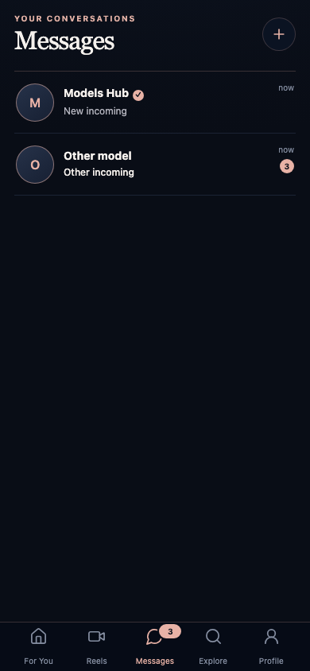
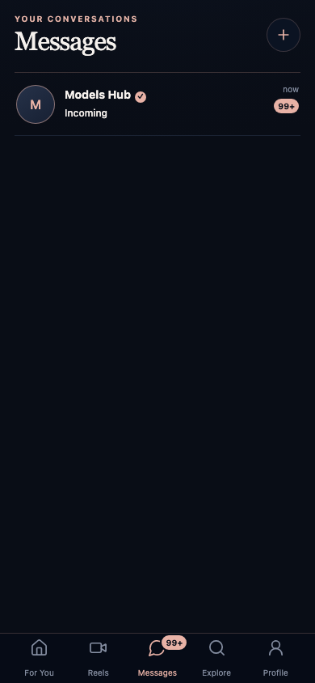

# GPoint Unread Messages — verification, 2026-10-03

Implementation: `codex/unread-messages`, forked from owner-approved plan commit `dfbfd19efd7d1e8ede95746712afb5b9b98e039c`. Final exact commit is supplied with the delivery message and can be obtained with `git rev-parse HEAD`. Production deployment, production migration and working runtime mutation were NOT performed. MAXIBOT was not modified. GitHub access used CLI/SSH only.

## Architecture and scope

AGATA's existing Message gains nullable `incoming_read_at`, with a partial unread index. Existing User, Character, Relationship, Conversation and Consent remain the ownership/eligibility authorities; no second message store or materialized counter. Only persisted, undeleted real-world incoming assistant rows in owned GPoint conversations count. User/system messages do not count. Existing ingestion uniqueness remains responsible for duplicate delivery.

Existing AGATA internal API gains lightweight grouped unread summary and bounded, atomic per-message acknowledgements; Inbox/history receive additive read fields. Existing GPoint AgataIntegrationService/client/contracts/controller extend these operations and derive identity from the authenticated session. Prisma schema is unchanged; existing approved-creator eligibility is checked in bulk. Existing chat send, inference jobs, transport, memory consent, age policy and UI design are preserved.

One authenticated React Query provider feeds both navigation and Inbox. Counts poll at 3 seconds with randomized initial phase, hidden-app pause, bounded exponential failure backoff and cancellation. Only visible incoming bubbles in the existing chat viewport are acknowledged, in deduplicated batches up to 100. History GET remains read-only. The first summary reconciles Inbox once; subsequent unchanged polls avoid Inbox hydration/decryption.

## Verification results

| Check | Result |
|---|---|
| `pnpm test` | 79 passed: API45 + MiniApp26 + agata-client6 + contracts2; zero skipped |
| `pnpm typecheck` | PASS |
| `pnpm build` | PASS |
| Isolated AGATA pytest | 99 passed, zero skipped; configured PostgreSQL and non-bypass RLS role |
| Fresh/legacy baseline test, separate run | 1 passed; run before full suite because it requires empty schema |
| API integration | 6 passed, zero skipped |
| Real-stack HTTP checks | 2 passed, zero skipped |
| Full mobile browser-smoke suite | 31 passed, including 21 Messages/unread cases and existing age/boot cases |
| `git diff --check` | PASS |
| 390px screenshot inspection | PASS for clipping/overlap/overflow; OWNER_REVIEW_REQUIRED for visual acceptance |

Real HTTP path: local GPoint API `:3197` → AGATA `:8197` → isolated PostgreSQL. Two conversations began with 2 and 1 unread; acknowledging one explicit incoming ID produced 1 and 1 (aggregate3→2). Fetching history changed nothing. Duplicate acknowledgement changed nothing. A new authenticated session saw persisted state. Another real GPoint user's attempt returned404 without mutation. [Recorded result](2026-10-03-unread-messages/real-http-result.json).

Browser coverage includes navigation count outside Messages, independent dialog counts, read/back/reopen, refresh, hidden app, off-screen long history, failed acknowledgement retry, delayed inference, late poll cancellation, no overlapping polls, unchanged-poll Inbox request count, zero and1/multi-digit/99+ display, 360/390/393/430px, exact accessible counts, and mounted-provider identity change with an old response pending. After A→B the old cache is removed, releasing A cannot flash its99 count in B, and B continues polling.

Server coverage includes repeated/duplicate ingestion, original read timestamp preservation, concurrent incoming insertion, malformed/oversized batches, consent/access rejection, whole-batch rollback for foreign IDs, matching external IDs across different tenants, more than30 conversations, deleted/inactive exclusion and both migration roles.

## TDD and independent review

Feature-specific RED was observed before each implementation phase: missing persistence; missing server/client/controller contracts; missing queue/poll policy; missing UI badges. A stale-zero Inbox regression also failed before its fix.

One independent fresh-context reviewer (`gpt-6-astra`) examined the complete branch against approved spec/plan and their explicit review-focus cases. It found no Critical or Minor items, two Important product defects and one Important coverage gap:

1. Forced-RLS migration could enumerate zero tenants and silently mark old history unread: restricted-role upgrade regression failed before the fix, then passed. Migration now fails closed without an explicit complete tenant inventory for restricted roles; two-tenant baseline tested under privileged and non-bypass roles.
2. First successful summary could leave a preexisting empty Inbox stale: delayed-first-summary/new-dialog regression failed before the fix, then passed. First snapshot now reconciles Inbox; unchanged-poll optimization remains.
3. Account-switch pending-response coverage missing: added a mounted real provider/shared QueryClient harness. Existing cancellation implementation passed; no invented product failure.

After one required fix pass, full suites were rerun and passed. Per Native methodology, no second reviewer was dispatched; fixes are backed by RED→GREEN and the green suites. Reviewer deferred production capacity/execution (unauthorized) and visual acceptance (owner gate); rulings below cover both.

## Migration and operational limitations

Pending **AGATA migration agata0010**, from agata0009. Readiness pins advance with it. Existing history receives a migration-time accounting baseline, not evidence of historical viewing or memory consent. New assistant rows have NULL read state. Migration holds a transactional lock against insertion while establishing baseline; production lock duration must be considered during a separately authorized release. No Prisma migration.

RLS stays enabled. Superuser/BYPASSRLS migrators enumerate all tenants. A restricted migrator MUST receive `AGATA_MIGRATION_TENANT_IDS` as a comma-separated, operator-verified complete tenant UUID inventory. Missing or unavailable tenant IDs fail and roll back the migration. An omitted tenant in an explicitly supplied incomplete inventory cannot be discovered through forced RLS; the release operator must verify inventory completeness before authorizing production. No new runtime environment option is required; this option is migration-only.

Polling is eventual, not push: normally one3-second interval plus network/server time; first poll can wait up to3seconds for jitter. Suspension refreshes on return. Visibility means a message is available for viewing, not proof that its text was read. Current feature targets existing user-to-AI chat; no human-to-human channel or Telegram push.

With50000 read rows and36 unread across35 dialogs, 20 local grouped count executions averaged0.752ms, maximum3.8ms; EXPLAIN used `messages_unread_incoming_idx`, server execution0.114ms. [Raw plan/timing](2026-10-03-unread-messages/query-benchmark.json). This measures one local query, not API throughput or production capacity. At1000 concurrently active users, three-second polling requires roughly333 requests/second; deployment-level load testing remains necessary before such capacity claims.

## Screenshots

OWNER_REVIEW_REQUIRED. Synthetic data, existing GPoint tokens/components, no design replacement.




## Reproduce without production

Use the feature branch and a fresh, explicitly disposable local PostgreSQL16/pgvector database. Never point these tests at production; migration tests create/drop dedicated test databases and the baseline/RLS suites require their own empty schemas. Python3.12+, Node/pnpm per repository. Install `pnpm install --frozen-lockfile`; create a local venv and `pip install -e 'services/agata[test]'`.

AGATA test environment: `AGATA_TEST_DATABASE_URL` (psycopg admin DSN with CREATE DATABASE), `AGATA_DATABASE_URL` (asyncpg), `AGATA_RLS_TEST_DATABASE_URL` (dedicated NOSUPERUSER/NOBYPASSRLS owner database, name ending `_agata_test`), `AGATA_TENANT_ID`, disposable `AGATA_INTERNAL_API_TOKEN`, `AGATA_LLM_PROVIDER=disabled`, base64 32-byte disposable `AGATA_MESSAGE_AEAD_KEY` and request/retrieval/shadow/response HMAC keys. Provision vector/pgcrypto and apply Alembic to the primary test DB. Keep production credentials out of the environment. For restricted-role migration tests provide all fixture tenants using the new migration inventory as demonstrated in tests.

Run from the repository root with that environment:

```sh
python -m pytest services/agata/tests --ignore=services/agata/tests/test_postgres_baseline.py -q
pnpm test
pnpm typecheck
pnpm build
pnpm exec playwright test -c playwright.browser-smoke.config.ts
```

Run `test_postgres_baseline.py` separately against its fresh database. Before repeating the full suite, reset ONLY the designated disposable RLS test schema: the preexisting age-policy test starts from an empty schema. Feature migration tests allocate/drop their own databases.

For API integration, provide a separate Prisma-migrated disposable GPoint test database (`DATABASE_URL`), `NODE_ENV=test`, `DEV_BROWSER_AUTH=true`; start a local API or set `GPOINT_API_URL` to its loopback address for root real-stack tests. `pnpm test:integration` runs session/ownership filtering and public routes; the upstream route adapter fixture is intentionally mocked there, while AGATA accounting and the recorded real HTTP path separately verify persistence.

To inspect UI interactively, run the existing browser fixture suite with `--headed` or `--ui`; it automatically starts the local Mini App and injects synthetic message API fixtures. This is UI simulation, not production data. Real backend accounting is verified by the PostgreSQL/HTTP tests above.

## Rulings made (Native ledger, exhaustive)

Task 1: Ruling: migration advances head; existing API/Worker readiness pins agata0009 — update readiness to agata0010 and test old-head rejection, necessary after migration; no runtime operation. Cost if wrong: false readiness, covered by health tests.
Task 3: Ruling: existing API construction uses AgataIntegrationService — extend this adapter with the two new methods; preserve the boundary rather than bypass it. Cost if wrong: adapter typing/routing defect, covered by transport and integration tests.
Task 5: Ruling: independent whole-change review runs while phase 5 final validation/report is in progress; phase 5 remains incomplete until findings and full tests are resolved. Cost if wrong: report drift; final commit/tests include all fixes.
Final: Ruling: restricted RLS migrators cannot discover hidden tenants — require operator-supplied complete AGATA_MIGRATION_TENANT_IDS inventory and fail closed when absent; privileged migrators enumerate all. RLS remains enabled. Cost if wrong: operator omission can skip an unlisted tenant; production release must verify inventory, no production migration authorized here.
Final: Ruling: production execution/capacity review deferred as explicitly unauthorized; local timings only. Cost if wrong: capacity needs deployment-level testing before scale claims.
Final: Ruling: visual acceptance remains owner review after automated screenshots, no self-approval. Cost if wrong: owner may request scoped style correction.

Deferred minors: none. Main checkout remains untouched; feature branch is intended to be pushed, with integration into main and production release separate.
